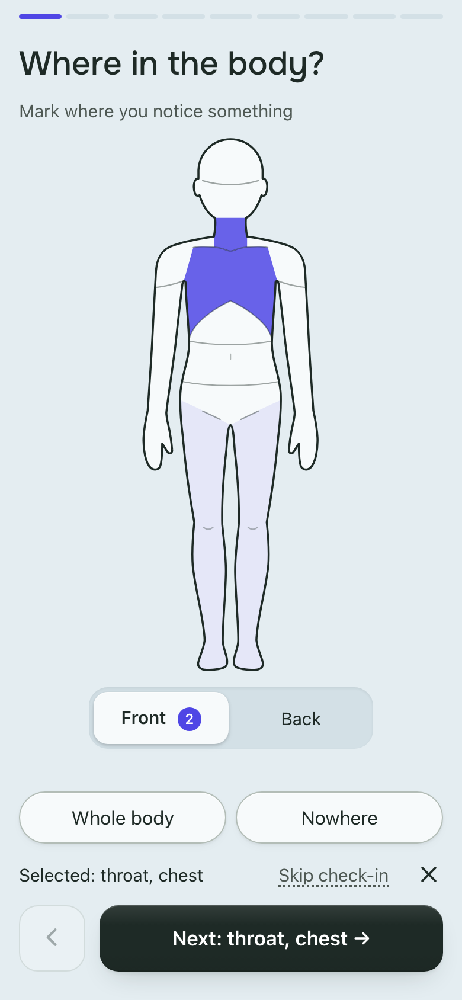

<!-- SPDX-License-Identifier: AGPL-3.0-or-later -->

# Emo

A minute-long check-in on what your body feels: where, what it is like, how
strong, and a word for it if one comes. Emo reminds you three times a day, at
random moments. In English, Ukrainian and Russian.



**Try it at [emo.podgorniy.net](https://emo.podgorniy.net)**: free, sign up with
your email. Or [run your own](#running-your-own-instance).

## An app without the app store

Open the site on your phone and add it to the home screen (iPhone: Share → Add
to Home Screen; Android: Install app). From then on it opens like any other app,
full screen, with its own icon, and sends the reminders. On iPhone, reminders
only work once it is on the home screen.

Works in Safari 16.4+, Chrome and Edge 111+, Firefox 115+.

## Works without a connection

Emo keeps the app and your entries on your device. No signal on a plane or in
the metro? Check in anyway: entries are saved on the phone and sync once you are
back online, to your other devices too. A thin "Offline" strip at the top tells
you when it can't reach the server.

## Privacy and security

- **Only you can read your entries.** They are encrypted on your device; the
  server stores them but cannot read them, and neither can whoever runs it.
- **Keep your passphrase or recovery key.** Lose both and the entries are gone:
  nobody can recover them.
- **No ads, analytics or trackers.** No third-party scripts; one cookie keeps
  you signed in.
- **Export or delete any time** in Settings → Data and keys.
- **Free software (AGPL).** Settings → About → Source code downloads the exact
  version the server runs.

What the server does see (your email, reminder settings, when entries arrive) is
listed in the [privacy notice](https://emo.podgorniy.net/privacy.html).
emo.podgorniy.net is run by the author on one server, free and best effort:
export now and then.

**Why it asks what it asks:** the
[methodology](https://emo.podgorniy.net/methodology) gives the research behind
each question.

**Not a medical device.** Emo does not diagnose or treat anything and does not
replace a therapist. In crisis, contact local emergency services or
[a helpline](https://findahelpline.com).

## Running your own instance

You need a Linux server (1 GB RAM, or swap: it builds the image), a domain or
subdomain whose DNS `A` record points to it, ports 80 and 443 open, and an SMTP
account: sign-in works by emailed codes. On a fresh Debian or Ubuntu, as root:

```bash
# Once: the tools, Docker and the code
apt-get install -y curl make git cron rsync openssl
curl -fsSL https://get.docker.com | sh   # Docker already from Ubuntu (docker.io)? apt-get install -y docker-compose-v2
git clone https://github.com/podgorniy/emo.git /srv/emo && cd /srv/emo

# Configure: secrets, the HTTPS address and your email (builds the image)
make init DOMAIN=emo.example.org EMAIL=you@example.org
nano .env                # SMTP_HOST, SMTP_PORT, SMTP_SECURE, SMTP_USER, SMTP_PASS, SMTP_FROM

# Start: the app, and Caddy with a Let's Encrypt certificate
make up
make smoke SEND=1        # sends a sample sign-in mail to EMAIL, shows what SMTP answered
# Open https://emo.example.org and register: anyone may (REGISTRATION=open);
# REGISTRATION=invite in .env closes it, then `make invite` prints a code

# Nightly backups and a health ping every 5 minutes; set PING_URL in .env
# first (a free healthchecks.io check) to be mailed when the server is down
make cron
```

If the sample mail lands in spam or never arrives, set up SPF, DKIM and DMARC
for the sending domain ([`llm/ops.md`](llm/ops.md) §2.5): nobody can sign in
without working mail.

| Day to day                    | On the server                    | From your own machine (after `git push`)             |
| :---------------------------- | :------------------------------- | :--------------------------------------------------- |
| Update                        | `make update`                    | `make deploy DEPLOY_HOST=root@emo.example.org`       |
| Update a checkout without git |                                  | `make deploy-rsync DEPLOY_HOST=root@emo.example.org` |
| Roll back                     | `EMO_IMAGE_TAG=<commit> make up` |                                                      |
| Back up now / off the box     | `make backup`                    | `make backup-pull DEPLOY_HOST=root@emo.example.org`  |
| Watch                         | `make logs`, `make stats`        |                                                      |

`make update` pulls, builds, backs up, restarts and smoke-tests; it stops when
the new `CHANGELOG.md` lines name a **Manual step**. Everything runs through
`make`; `make` alone lists the everyday targets. After changing the code on the
server, `make docker-build` and `make up` again.

When another web server already holds ports 80 and 443 on that host, run
`make init` without `DOMAIN`, set `BASE_URL` yourself and point your proxy at
`127.0.0.1:PORT` (8080 unless `.env` sets another) ([`llm/ops.md`](llm/ops.md)
§2.3).

Backups, restore, updates, monitoring and every operator command are in
[`llm/ops.md`](llm/ops.md). Read [`CHANGELOG.md`](CHANGELOG.md) before every
update: manual steps are marked there.

**You are the operator of your instance.** Before others sign up, set
`OPERATOR_CONTACT`, review `client/public/privacy.html` (add who you are and
your jurisdiction) and set `PRIVACY_NOTICE_URL` ([`llm/ops.md`](llm/ops.md)
§2.6).

## Development

Requires Deno 2.9.6 (`.tool-versions`). To try it locally:

```bash
make init        # once: a .env with fresh secrets (no SMTP needed for dev)
make dev         # the server on :8081 and Vite with hot reload on :5173
```

Open http://localhost:5173 and sign in with any address: the code is printed in
the `make dev` terminal, not mailed.

```bash
make ci          # format check, lint, tests, build with the size budgets
make e2e         # Playwright on the built binary: CSP, accessibility, flows, thumb reach
make perf        # Lighthouse, sizes and benches into perf/report/
make capture     # a screenshot of every screen state, into e2e/report/capture/
```

`make dev` prints sign-in codes and other mail to its terminal, even with
`SMTP_HOST` set; `DEV_MAIL=smtp` in `.env` sends them for real. It runs next to
`make up` on its own port and database (`DEV_PORT=8090` picks another), so a
browser never mixes the two; operator targets take `DEV=1` to act on it:
`make invite DEV=1`.

The documentation is in [`llm/`](llm/README.md): one file per concern
(methodology, data, architecture, API, UI, operations, development), written to
be read by people and by coding agents alike; its README maps them. Start with
[`llm/development.md`](llm/development.md) for tests, CI, releases and
conventions. Open work is in [`llm/todo.md`](llm/todo.md). `design/` holds the
reference mockups and prototype sources, not production code.

## Forking

The code names no particular server; the hosted instance appears only in this
README. To run a fork under your own name:

- rewrite this README's introduction and links;
- review `client/public/privacy.html` (who runs it, jurisdiction, retention,
  mail provider) and the project link in it and in
  `client/public/methodology.html`;
- set `OPERATOR_CONTACT`, `CRISIS_URL` (a local service) and, if you serve the
  source from elsewhere, `SOURCE_URL` in `.env`;
- the display name lives in `shared/i18n/ui.*.ts`,
  `client/public/manifest.webmanifest` and the page titles; the internal `emo`
  identifiers (database, storage keys, encryption contexts) must never change
  ([`llm/README.md`](llm/README.md) §3).

Under the AGPL, a modified server must offer its users its own source; the
built-in `/source.tar.gz` does that for whatever you build.

## Contributing and reporting

Bugs and ideas: [GitHub issues](https://github.com/podgorniy/emo/issues). In the
app, Settings → Data and keys → Copy diagnostics gives a report without any of
your content. Security problems: privately, as described in
[`SECURITY.md`](SECURITY.md), not in a public issue.

## License

Copyright (C) 2026 podgorniy. [AGPL-3.0-or-later](LICENSE), including `design/`.
Fonts in `client/public/fonts` are under the SIL Open Font License 1.1 (see the
`OFL.txt` in each folder). The word list behind "Suggest a passphrase"
(`client/src/lib/passphraseWords.ts`) is the EFF Large Wordlist by the
Electronic Frontier Foundation, under CC BY 3.0 US, with some words removed.
